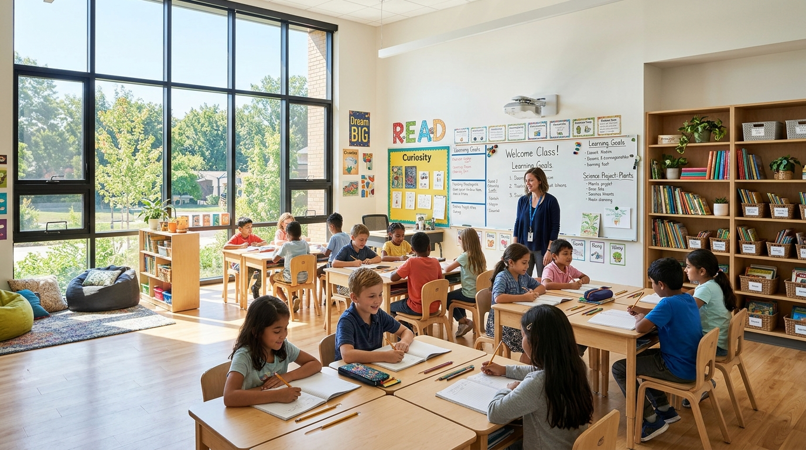

# Achievers Academy — Official School Website

A modern, accessible, responsive static website for **Achievers Academy**, designed to present a credible, welcoming, and academically distinguished digital presence for parents, students, educators, and the community.

Built using clean, semantic **HTML5**, modern **CSS3**, and **Vanilla JavaScript** without external frameworks or dependencies.

---

## 1. Project Overview & Architecture

### Key Features
- **Authentic Academic Aesthetic**: Tailored color palette featuring deep forest green (`#154231`), warm burnished gold (`#c59b27`), crisp white, and subtle warm neutrals.
- **Human-Centred Typography**: Elegant serif headings (*Lora*) paired with a readable sans-serif typeface (*Plus Jakarta Sans*).
- **Responsive Across All Viewports**: Tested for small mobile devices, tablets, laptops, and large desktop screens.
- **Accessible & SEO-Optimized**: Proper heading hierarchy, semantic landmarks (`<header>`, `<nav>`, `<main>`, `<section>`, `<footer>`), visible focus states, skip-to-content links, descriptive alt text, and Open Graph metadata.
- **Filterable Interactive Gallery**: 10 educational photos and illustrations categorized by Environment, Classrooms, Students, Events, and Sports, equipped with an accessible, keyboard-friendly fullscreen lightbox (Escape, Left/Right arrow keys).
- **Admissions Application System**: Complete admissions application form with field validation (RFC-compliant email, flexible telephone formats, required fields), real-time error feedback, and a transparent static demonstration preview modal.

---

## 2. Directory Structure

```text
achievers-academy/
├── index.html              # Homepage: Hero, Philosophy, Academic Preview, Gallery, Contacts
├── about.html              # About Us: School Overview, Mission, Vision, Core Values, Leadership
├── academics.html          # Academics: Learning Stages, Curriculum Focus, Methodology, Clubs
├── admissions.html         # Admissions: 4-Step Process, Checklist, Online Application Form
├── gallery.html            # Gallery: Categorized Moments with Fullscreen Lightbox
├── contact.html            # Contact Us: Campus Address, Phone, Email, Office Hours, Inquiry Form
├── css/
│   ├── style.css           # Core Design Tokens, Typography, Layouts, Components, Forms, Modals
│   └── responsive.css      # Viewport Breakpoints (<=1100px, <=992px, <=768px, <=480px, Print)
├── js/
│   ├── main.js             # Central Config (SCHOOL_CONFIG), Mobile Nav Drawer, Sticky Header
│   ├── forms.js            # Admissions & Contact validation, Preview Modals, Accessible Alerts
│   └── gallery.js          # Category Filtering, Lightbox Trapping, Keyboard Navigation
├── images/
│   ├── logo.svg            # Scalable Vector Crest & Wordmark
│   ├── favicon.svg         # Tab Icon Crest
│   ├── hero-campus.jpg     # Main Campus Photography Banner
│   ├── avatar-placeholder.svg # Leadership Team Silhouette Placeholder
│   └── gallery/
│       ├── environment-campus.jpg
│       ├── classroom-learning.jpg
│       ├── science-lab.jpg
│       ├── school-library.jpg
│       ├── sports-field.jpg
│       ├── events-celebration.jpg
│       ├── arts-creativity.svg
│       ├── music-performance.svg
│       ├── student-leadership.svg
│       └── stem-robotics.svg
└── README.md               # Website Maintenance & Handover Documentation
```

---

## 3. Central Place for School Details

School details are managed in **`js/main.js`** inside the `SCHOOL_CONFIG` constant. When scripts run, they reference this central configuration:

```javascript
const SCHOOL_CONFIG = {
  name: "Achievers Academy",
  tagline: "Excellence • Character • Wisdom",
  logoPath: "images/logo.svg",
  faviconPath: "images/favicon.svg",
  phone: "+1 (555) 019-2834",               // Update with verified school phone
  email: "admissions@achieversacademy.edu", // Update with verified school email
  address: {
    line1: "168 Parliamentary Extension",
    line2: "Cross River State",
    city: "Calabar",
    postalCode: "540211",
    country: "Nigeria"
  },
  officeHours: "Monday – Friday: 7:30 AM – 2:00 PM",
  admissionsStatus: "Admissions Open for 2026/2027 Academic Session",
  socialLinks: {
    facebook: "#",
    instagram: "#",
    linkedin: "#",
    youtube: "#"
  },
  formEndpoints: {
    admissions: "", // Enter Formspree or custom API URL here for live submissions
    contact: ""
  }
};
```

To update visible text in HTML headers or footers, edit the corresponding sections in each `.html` file. Each file contains consistent, well-commented blocks.

---

## 4. How to Replace Images & Logo

### A. Replacing the School Logo / Crest
1. Place your official vector logo in `images/logo.svg` or a high-resolution PNG in `images/logo.png`.
2. If using PNG, update the `src` attribute in the `<header>` and `<footer>` of each page:
   ```html
   
   ```

### B. Replacing the Hero Image
- Replace `images/hero-campus.jpg` with a landscape photograph (recommended resolution: `1920x1080px` or `1600x900px`, JPEG or WebP format, under 400KB for rapid load time).

### C. Replacing Gallery Images
The gallery uses standard images located in `images/gallery/`. To replace any image with an actual photograph of Achievers Academy students or facilities:
1. Save your photograph into `images/gallery/` matching the filename, or with a new filename:
   - `environment-campus.jpg` — Exterior buildings, lawns, gate, courtyards.
   - `classroom-learning.jpg` — Teachers and students during lessons.
   - `science-lab.jpg` — Chemistry, Physics, or Biology laboratory sessions.
   - `school-library.jpg` — Reading tables and bookstacks.
   - `sports-field.jpg` — Football, track, basketball, or athletics.
   - `events-celebration.jpg` — Prize-giving day, graduation, cultural days.
2. In `gallery.html`, update the corresponding `src` and `alt` attribute describing the real photo:
   ```html
   <article class="gallery-item" data-category="classrooms" tabindex="0" role="button">
     
     <div class="gallery-overlay">
       <span class="gallery-category-tag">Classrooms &amp; Learning</span>
       <p class="gallery-caption">Primary Mathematics Workshop</p>
     </div>
   </article>
   ```

### D. Updating Leadership Team Portraits
- Replace `images/avatar-placeholder.svg` in `about.html` with real portraits of the Principal, Vice Principal, and faculty heads (recommended aspect ratio: `3:4` or `1:1`, e.g. `600x800px`).

---

## 5. Connecting Forms for Live Delivery

This website is delivered as a lightweight static project. To protect integrity and prevent misleading parents, the forms **do not falsely claim** that applications have been emailed or stored in a database. Instead, they perform client-side validation and display a clear preview modal with captured data.

### To Enable Live Form Submissions:

#### Option A: Free & Low-Code Service (Formspree, Formkeep, or Basin)
1. Register a free account at [Formspree.io](https://formspree.io) or [usebasin.com](https://usebasin.com).
2. Create a form for **Admissions** and one for **Contact**.
3. In `js/main.js`, add your endpoint URLs to `SCHOOL_CONFIG`:
   ```javascript
   formEndpoints: {
     admissions: "https://formspree.io/f/your_admissions_id",
     contact: "https://formspree.io/f/your_contact_id"
   }
   ```
4. Form submissions will now automatically POST the validated JSON payload directly to your email inbox!

#### Option B: School Backend or Database API
If the school develops an internal database, ERP, or Google Sheets Webhook:
- Point `formEndpoints.admissions` to your HTTPS REST endpoint (e.g. `https://api.achieversacademy.edu/admissions`).

---

## 6. How to Host & Deploy

Since there is no server-side build step or database, this website can be deployed in seconds:

### Deploying to GitHub Pages
1. Push this folder to a GitHub repository.
2. In your repository, go to **Settings** > **Pages**.
3. Under **Branch**, select `main` (or `master`) and folder `/ (root)`.
4. Click **Save**. Your school website will be live at `https://<username>.github.io/<repo-name>/`.

### Deploying to Netlify / Vercel
1. Drag and drop the `Achievers Academy` folder directly onto the [Netlify Drop](https://app.netlify.com/drop) interface or import via GitHub on [Vercel](https://vercel.com).
2. Set build command to empty and publish directory to `.`.
3. It will deploy instantly with a free SSL certificate.

---

## 7. Customization Notes
- **Colors**: Edit CSS variables in `:root` inside `css/style.css` (e.g., `--color-primary`, `--color-accent`).
- **Interactive Google Maps**: In `contact.html`, an optional map container is prepared. Once the school verifies their Google Business listing, paste their Google Maps `<iframe>` directly inside the `.map-placeholder-box` container.
